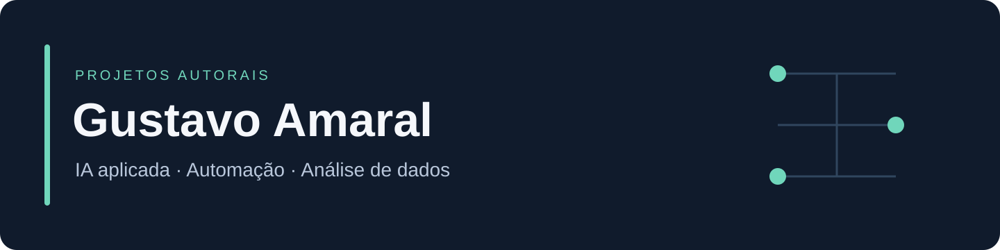
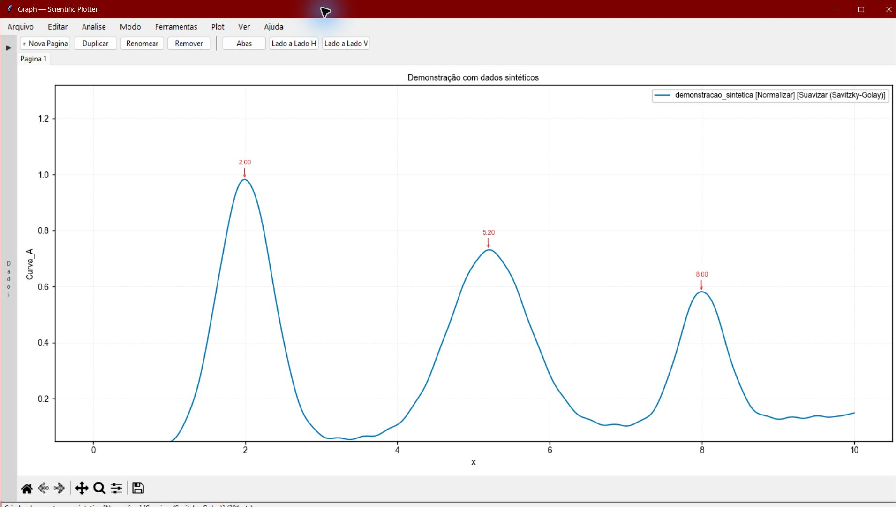
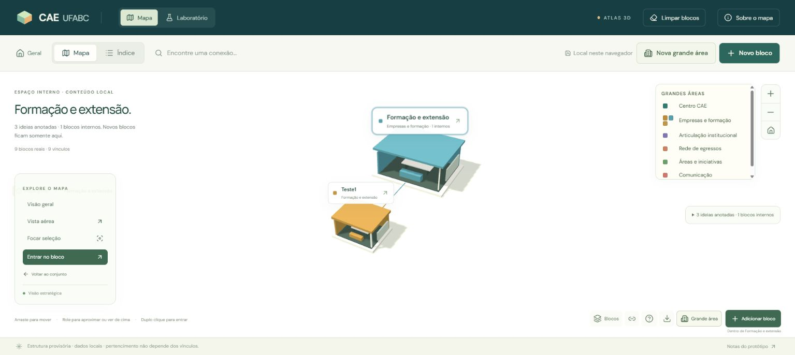

# Gustavo Amaral

My projects start with something I want to be able to do: use a video with my AI assistants, work more easily with a curve, find a card in my collection or see how the parts of a project connect.

I use AI during development and, in some cases, within the application itself. My work involves defining the need, building the workflow, integrating tools and inspecting the results to understand what still needs improvement.

[LinkedIn](https://www.linkedin.com/in/gustavo-henrique-de-quequi-do-amaral-24a4192ba/) · [Português](README.md)

## Projects to explore

**All projects are in development.** Dates below refer to each project’s records; where the start is unknown, the earliest available record is shown.

Presentation updated on November 17, 2026.

| Project | Where to start |
| --- | --- |
| [**CentralVideo**](https://github.com/EagleKhan0505/centralvideo) | Turning videos into evidence my assistants can consult, with processing suited to my computer. Estimated start: September 2026 · Last recorded update: November 3, 2026 |
| [**Graph**](https://github.com/EagleKhan0505/graph-scientific-plotter) | A natural-language request, a synthetic curve and three operations executed in the scientific analysis interface. Earliest local record: May 8, 2026 · Last recorded update: September 4, 2026 |
| [**CAE · Spatial dashboard**](https://github.com/EagleKhan0505/cae-spatial-dashboard) | A 3D atlas for areas, initiatives and connections, alongside tools for organizing work. Platform created: November 9, 2026 · Last recorded update: November 12, 2026 |
| [**Magic Collection Manager**](https://github.com/EagleKhan0505/magic-collection-manager) | From my collection spreadsheet to card-text search, deck tracking and AI decision support in development. Earliest available record: October 29, 2026 · Last application update: unconfirmed |
| [**Crys and Alexa**](https://github.com/EagleKhan0505/crys-alexa) | An OpenAI API integration demonstrated by a question answered in the Alexa simulator. Earliest record: November 3, 2026 · Last recorded update: November 3, 2026 |

<table>
<tr><td width="50%"></td><td width="50%"></td></tr>
<tr><td><strong>Graph</strong> · analysis executed in the application</td><td><strong>CAE</strong> · spatial organization in 3D</td></tr>
</table>

Each presentation includes the project's context, implementation decisions and available evidence. Application images are real captures; illustrative diagrams and synthetic data are labeled.

Other explorations in progress

**SoundBubble** — computational acoustics research with simulation and interactive visualization. Research in development. 
Earliest record: October 26, 2026 · Last recorded update: November 17, 2026

**VibEats** — product and interface experiments, with a focus on visual experience. Prototype in development. 
Started: November 15, 2026 · Last recorded update: November 17, 2026

The presentations are public. Complete implementations and working data remain private.
