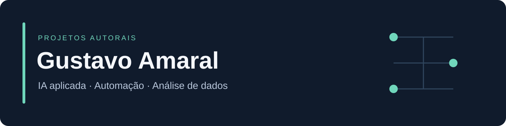
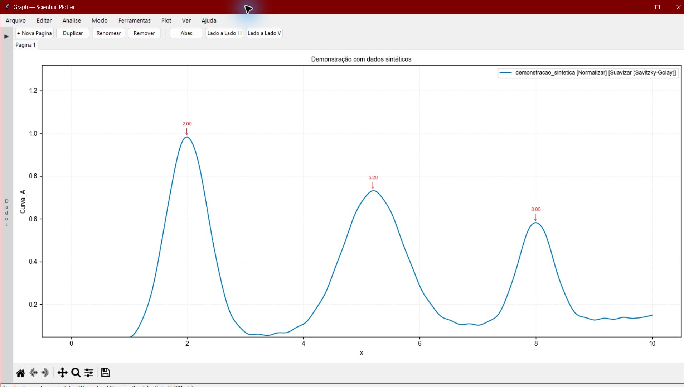
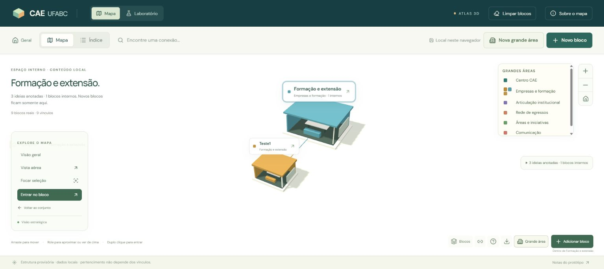

# Gustavo Amaral

Meus projetos começam com algo que quero conseguir fazer: usar um vídeo com os meus assistentes de IA, trabalhar melhor com uma curva, encontrar uma carta da minha coleção ou enxergar como as partes de um projeto se conectam.

Uso IA no desenvolvimento e, em alguns casos, dentro da própria aplicação. Meu trabalho passa por definir o que preciso, construir o fluxo, integrar ferramentas e voltar aos resultados para entender o que ainda precisa melhorar.

[LinkedIn](https://www.linkedin.com/in/gustavo-henrique-de-quequi-do-amaral-24a4192ba/) · [English](README.en.md)

## Projetos para conhecer

| Projeto | Por onde começar |
| --- | --- |
| [**Central de Vídeos**](https://github.com/EagleKhan0505/centralvideo) | Como transformo vídeos em evidências consultáveis pelos meus assistentes, ajustando o processamento ao meu computador. |
| [**Graph**](https://github.com/EagleKhan0505/graph-scientific-plotter) | Um comando em português, uma curva sintética e três operações executadas na interface de análise científica. |
| [**CAE · Dashboard espacial**](https://github.com/EagleKhan0505/cae-spatial-dashboard) | Um atlas 3D para explorar áreas, iniciativas e conexões, acompanhado de ferramentas para organizar o trabalho. |
| [**Organizador Magic**](https://github.com/EagleKhan0505/magic-collection-manager) | Da planilha da minha coleção à busca por texto, aos decks e ao apoio à decisão por IA em desenvolvimento. |
| [**Crys e Alexa**](https://github.com/EagleKhan0505/crys-alexa) | A integração com a API da OpenAI vista por uma pergunta respondida no simulador da Alexa. |

<table>
<tr><td width="50%"></td><td width="50%"></td></tr>
<tr><td><strong>Graph</strong> · análise executada no aplicativo</td><td><strong>CAE</strong> · organização espacial em 3D</td></tr>
</table>

Cada apresentação traz o contexto do projeto, escolhas de construção e o que já consigo demonstrar. As imagens de aplicativos são capturas reais; esquemas ilustrativos e dados sintéticos estão identificados.

Outras explorações em andamento

**SoundBubble** — investigação em acústica computacional, com simulação e visualização interativa. Pesquisa em desenvolvimento.

**VibEats** — experimentos de produto e interface, com atenção à experiência visual. Protótipo em desenvolvimento.

As apresentações são públicas. As implementações completas e os dados de trabalho permanecem privados.
